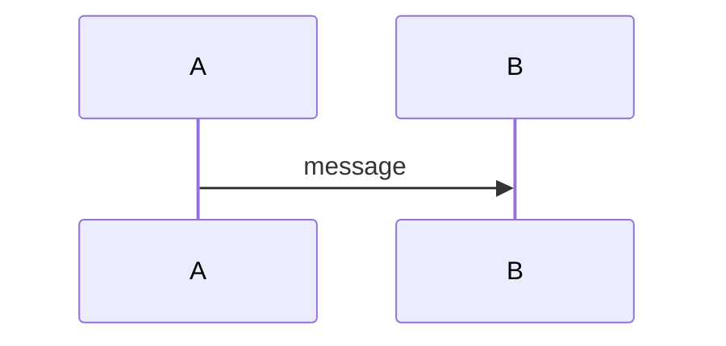

# Didar docs template

All docs live in `00-docs/`; images go in `00-docs/assets/`. Every change also goes through the `docs-change-approval` skill and must pass `npm run lint:docs` (markdownlint + mermaid rendering). Inline `markdownlint-disable` comments are ignored by config; do not rely on them.

## `index.md` — the nexus

A plain table of contents. Every doc page must be linked from here, with a one-line summary. Nested items for important sections (`file.md#anchor`).

```markdown
# Didar Documentation

## Table of Contents

1. [Glossary](glossary.md) — terms used across the docs.
2. [Requirements](requirements.md) — what didar must do.
   1. [Functional Requirements](requirements.md#functional-requirements)
```

## `glossary.md` — one table

Exactly one table with two columns, `Term` and `Definition`, sorted alphabetically by term.

```markdown
# Glossary

| Term | Definition |
| ---- | ---------- |
| Datagram | A single UDP packet. |
```

## `requirements.md` — three sections

Exactly three `##` sections, in this order: `Functional Requirements`, `Security Requirements`, `Performance Requirements`.

Each section has one table with three columns: `ID`, `Title`, `Description`.

- IDs are `{X}R-{#}`: `FR-` functional, `SR-` security, `PR-` performance. Numbers start at 1, are never reused, and are never renumbered (mark removed ones as *Withdrawn* in the description).
- Phase or toggle info goes in the description (e.g. "Phase 2. Can be disabled.").

**Every functional requirement has a mermaid `sequenceDiagram`**, under a `### FR-{#}: {Title}` heading placed after the functional table.

````markdown
## Functional Requirements

| ID | Title | Description |
| -- | ----- | ----------- |
| FR-1 | Example | What it does. |

### FR-1: Example


````

Security and performance requirements do not need diagrams.

## `architecture.md` — how didar is built

Sections in this order: intro paragraph, `## Constraints` (table: `Constraint`, `Decision`), `## Components` (table: `Component`, `Kind`, `Role`, plus a mermaid `flowchart`), `## Wire Format` (byte layouts in `text` code blocks, field and error-code tables), one `##` section per program (`## didard`, `## didar-agent`) as bullet lists, and `## Entity Relationships`.

**`## Entity Relationships` must contain a mermaid `erDiagram`** with relationships and attributes for every entity. Update it whenever a component, table, or relationship changes.

Unsettled designs are marked "(phase N draft)" in the heading. Decisions still open go in the `Constraints` table as "Open until ...".

## `api.md` — how to set up and use didar

Exactly two `##` sections, in this order: `Client` and `Server`.

- `## Client` has `### libdidar` (signatures in a `cpp` block, a table: `Function`, `Returns`, `Description`, and a usage `sequenceDiagram`) and `### didar-agent`.
- `## Server` has `### didard`.
- Each program section has a config table (`Config key`, `Flag`, `Default`, `Description`), an example config in an `ini` block, and `#### Setup` and `#### Forwarding` subsections, **each with a mermaid `sequenceDiagram`**.

## `guide.md` — how to use didar

A task-oriented walkthrough for users. One overview mermaid `flowchart` after the intro, then numbered `##` sections in the order a user needs them: `1. Build`, `2. Run the server`, `3. Use it from an existing app`, `4. Use it from your own code`, `5. Run with Docker` (with a table of every environment variable: `Variable`, `Image`, `Default`, `Flag`), `6. Troubleshooting` (table: `Message`, `Cause`, `Fix`). No test instructions: the guide is for users, not developers. Every command and code example must be verified against the current build before it is written. Option details belong in `api.md`; link there instead of repeating them.

## `prior-art.md` — existing solutions

An intro line with the date checked and the conclusion, then `## Projects` and `## Standards`, each a table with the columns `Project` (or `Standard`), then one column per requirement compared (e.g. `FR-1 single-port demultiplexing`). Name links go in the first column. End with `## Takeaways` as a bullet list. When requirements change, update the columns.
