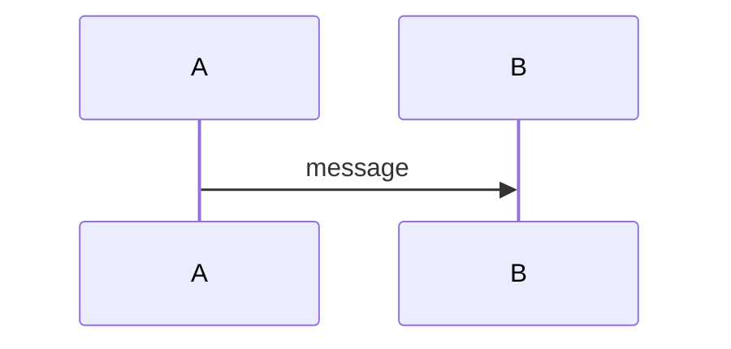

# Didar docs template

All docs live in `00-docs/`; images go in `00-docs/assets/`. Every change also goes through the `docs-change-approval` skill and must pass `npm run lint:docs` (markdownlint + mermaid rendering). Inline `markdownlint-disable` comments are ignored by config; do not rely on them.

## `index.md` — the nexus

A plain table of contents. Every doc page must be linked from here, with a one-line summary. Nested items for important sections (`file.md#anchor`).

```markdown
# Didar Documentation

## Table of Contents

1. [Glossary](glossary.md) — terms used across the docs.
2. [Requirements](requirements.md) — what didar must do.
   1. [Functional Requirements](requirements.md#functional-requirements)
```

## `glossary.md` — one table

Exactly one table with two columns, `Term` and `Definition`, sorted alphabetically by term.

```markdown
# Glossary

| Term | Definition |
| ---- | ---------- |
| Datagram | A single UDP packet. |
```

## `requirements.md` — three sections

Exactly three `##` sections, in this order: `Functional Requirements`, `Security Requirements`, `Performance Requirements`.

Each section has one table with three columns: `ID`, `Title`, `Description`.

- IDs are `{X}R-{#}`: `FR-` functional, `SR-` security, `PR-` performance. Numbers start at 1, are never reused, and are never renumbered (mark removed ones as *Withdrawn* in the description).
- Phase or toggle info goes in the description (e.g. "Phase 2. Can be disabled.").

**Every functional requirement has a mermaid `sequenceDiagram`**, under a `### FR-{#}: {Title}` heading placed after the functional table.

````markdown
## Functional Requirements

| ID | Title | Description |
| -- | ----- | ----------- |
| FR-1 | Example | What it does. |

### FR-1: Example


````

Security and performance requirements do not need diagrams.
