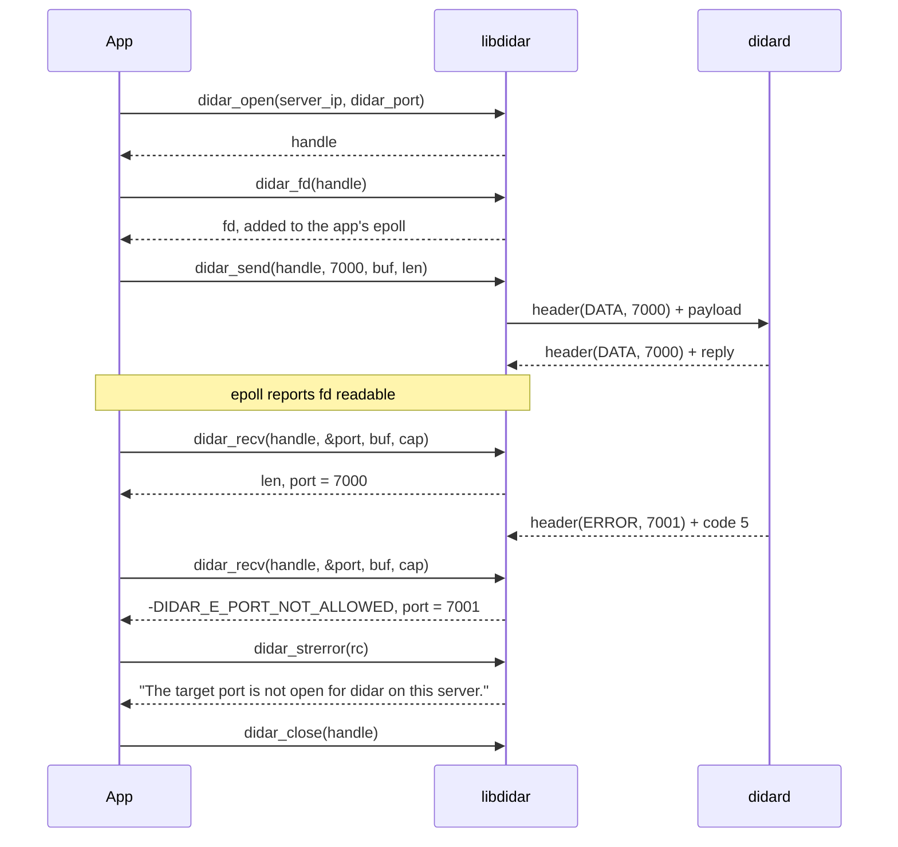
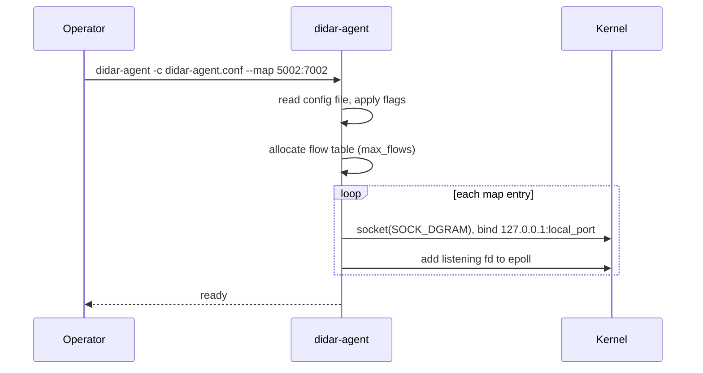
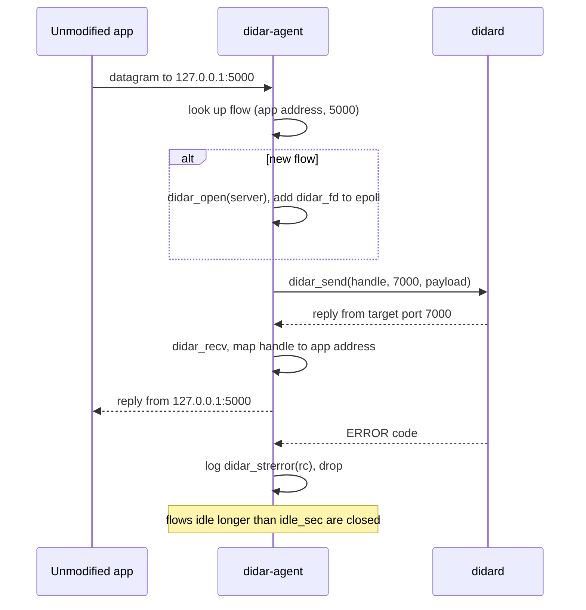
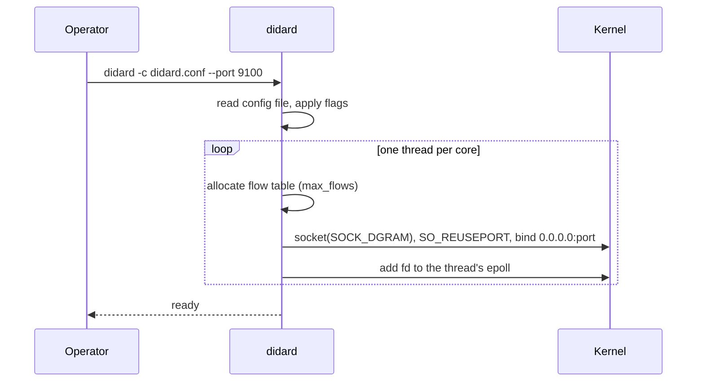
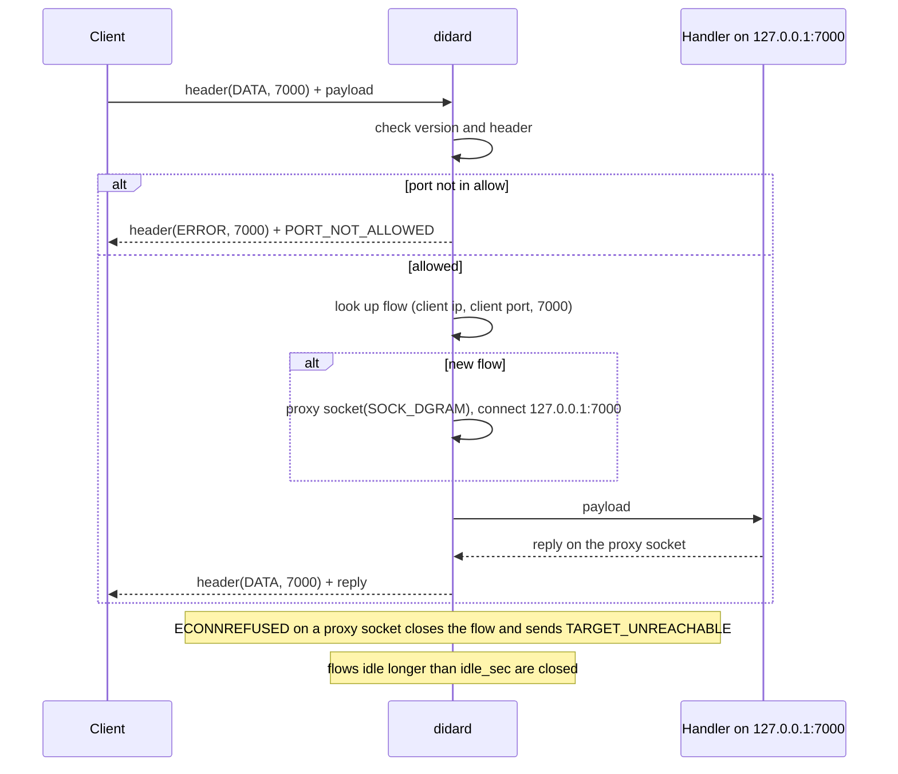

# API

How to set up and use each side of didar. See [Architecture](architecture.md) for the internals.

## Client

There are two ways to use didar on the client: link `libdidar` into the app, or run `didar-agent` so unmodified apps can use it.

### libdidar

A C-callable (`extern "C"`) library. One handle talks to one server; the target port is given per call. Sockets are non-blocking datagram sockets, and nothing is allocated after `didar_open`.

```cpp
didar_client* didar_open(const char* server_ip, uint16_t didar_port);
int           didar_send(didar_client* c, uint16_t target_port, const void* buf, size_t len);
int           didar_recv(didar_client* c, uint16_t* source_port, void* buf, size_t cap);
int           didar_fd(didar_client* c);
void          didar_close(didar_client* c);
const char*   didar_strerror(int rc);
```

| Function | Returns | Description |
| -------- | ------- | ----------- |
| `didar_open` | Handle, or `NULL` with `errno` set | Creates a datagram socket for the given server. |
| `didar_send` | Payload bytes sent, or a negative code | Adds the didar header and sends one datagram to `target_port`. `-EMSGSIZE` if the payload is over 1468 bytes. |
| `didar_recv` | Payload bytes received, or a negative code | Reads one datagram and sets `source_port`. `-EAGAIN` when nothing is waiting. A server error is returned as `-DIDAR_E_*`. |
| `didar_fd` | File descriptor | For the app's own `epoll` or `poll` loop. |
| `didar_close` | Nothing | Closes the socket and frees the handle. |
| `didar_strerror` | Message | Describes both `-errno` and `-DIDAR_E_*` codes. |

Didar error codes start at 1000 so they never collide with `errno`: `DIDAR_E_TARGET_UNREACHABLE` is 1001, up to `DIDAR_E_PORT_NOT_ALLOWED` at 1005, matching the wire codes in [Architecture](architecture.md#error-datagram-5-bytes).



### didar-agent

Maps local ports to target ports. It listens only on `127.0.0.1`.

| Config key | Flag | Default | Description |
| ---------- | ---- | ------- | ----------- |
| — | `-c`, `--config <file>` | None | Config file to read. |
| `server` | `--server <ip:port>` | Required | The didard server and didar port. |
| `map` | `--map <local:target>` | Required | Local port to target port. Repeat for each mapping. |
| `max_flows` | `--max-flows <n>` | 4096 | Size of the flow table. |
| `idle_sec` | `--idle-sec <n>` | 60 | Idle seconds before a flow is closed. |

Flags override the config file.

```ini
# didar-agent.conf
server    = 203.0.113.5:9000
map       = 5000:7000
map       = 5001:7001
max_flows = 4096
idle_sec  = 60
```

Run it with `didar-agent -c didar-agent.conf`.

#### Setup



#### Forwarding



## Server

### didard

Listens on the didar port and forwards to allowed target ports on `127.0.0.1`.

| Config key | Flag | Default | Description |
| ---------- | ---- | ------- | ----------- |
| — | `-c`, `--config <file>` | None | Config file to read. |
| `port` | `--port <n>` | Required | The didar port. |
| `allow` | `--allow <p1,p2,...>` | Required | Target ports clients may reach. Anything else gets `PORT_NOT_ALLOWED`. |
| `max_flows` | `--max-flows <n>` | 65536 | Size of the flow table per thread. |
| `idle_sec` | `--idle-sec <n>` | 60 | Idle seconds before a flow is closed. |

Flags override the config file.

```ini
# didard.conf
port      = 9000
allow     = 7000,7001
max_flows = 65536
idle_sec  = 60
```

Run it with `didard -c didard.conf`.

#### Setup



#### Forwarding


