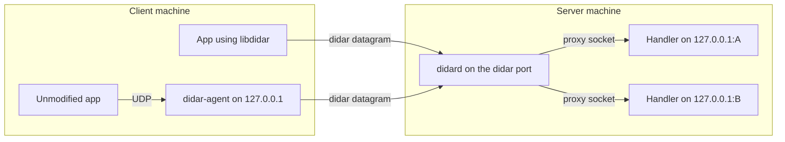
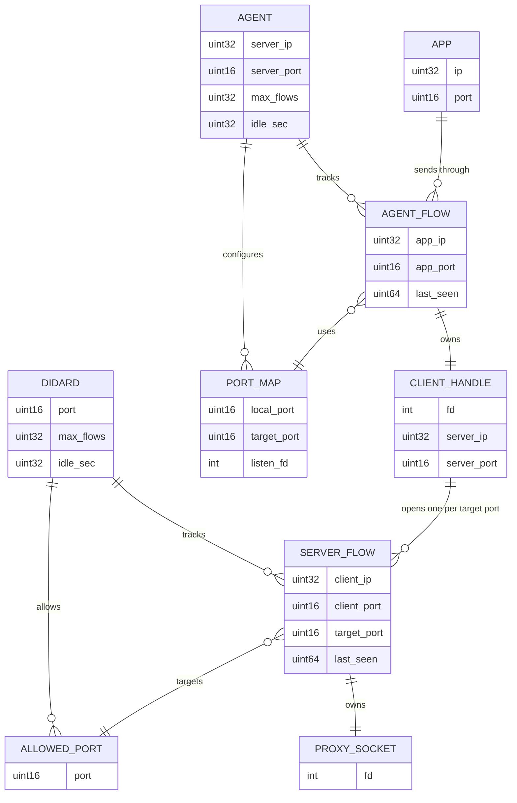

# Architecture

Didar is a UDP reverse proxy. Clients send every datagram to one didar port on the server, and the server forwards each one to the handler on its target port at `127.0.0.1`. Replies travel back the same way.

## Constraints

| Constraint | Decision |
| ---------- | -------- |
| Language | C++ (fixed), written C-style: structs and free functions, no STL containers, no exceptions or RTTI (`-fno-exceptions -fno-rtti`), no allocation on the hot path. |
| Platform | Linux only: `epoll`, `recvmmsg`/`sendmmsg`, `SO_REUSEPORT`. |
| Sockets | Datagram only (`SOCK_DGRAM`), never stream. One datagram in is one datagram out; didar adds no reliability or ordering. |
| Targets | Only `127.0.0.1:<port>` on the server, and only ports on the server's allow-list. |
| Crypto library | Open until phase 2. |

## Components

| Component | Kind | Role |
| --------- | ---- | ---- |
| `libdidar` | Library | Wire format (encode and decode) and the client API. Shared by all other components. |
| `didar-agent` | Client program | Maps local UDP ports to target ports so unmodified apps can use didar. Built on `libdidar`. |
| `didard` | Server program | Listens on the didar port and proxies each flow to its target port. |



## Wire Format

All fields are in network byte order.

### Header (4 bytes)

```text
| ver:4 | flags:4 | type:8 | target_port:16 |
```

| Field | Meaning |
| ----- | ------- |
| `ver` | Protocol version, currently 1. |
| `flags` | Bit 0: encrypted (phase 2). Other bits are reserved and must be 0. |
| `type` | 0 `DATA`, 1 `ERROR`. Handshake types are added in phase 2. |
| `target_port` | Client to server: the target port. Server to client: the port the reply or error comes from. |

A `DATA` datagram is the header followed by the payload. With a 1472-byte IPv4 payload budget, the largest client payload is 1468 bytes.

### Error datagram (5 bytes)

The header with `type = ERROR`, followed by a 1-byte code. Only the code is sent; `libdidar` turns it into a message.

| Code | Name | Message (client side) |
| ---- | ---- | --------------------- |
| 1 | `TARGET_UNREACHABLE` | Nothing is listening on the target port on the server. |
| 2 | `FLOW_TABLE_FULL` | Server has reached its maximum number of flows; try again later. |
| 3 | `BAD_VERSION` | Server does not support this protocol version. |
| 4 | `MALFORMED` | Server could not parse the datagram header. |
| 5 | `PORT_NOT_ALLOWED` | The target port is not open for didar on this server. |

### Encrypted datagram (phase 2 draft)

```text
| ver/flags:8 | session_id:24 | counter:64 | AEAD( target_port:16 | payload ) | tag:128 |
```

30 bytes of overhead, within the 32-byte limit of PR-1. The target port is inside the ciphertext (SR-1). This layout is a draft until the crypto library is chosen.

## didard

- **Event loop:** one thread per core, each with its own socket on the didar port (`SO_REUSEPORT`) and its own flow table, so threads share nothing. `epoll` with `recvmmsg`/`sendmmsg` batches up to 64 datagrams per system call.
- **Flows:** a flow is keyed by client IP, client port, and target port. Each flow owns one proxy socket, a datagram socket `connect()`ed to `127.0.0.1:<target_port>`, so replies on it belong to exactly that flow.
- **Flow table:** fixed-size open-addressing hash table, allocated at startup and sized by `max_flows`.
- **Allow-list:** a datagram for a port not in `allow` is answered with `PORT_NOT_ALLOWED` and no flow is created.
- **Errors:** `ECONNREFUSED` on a proxy socket (ICMP port unreachable) closes the flow and sends `TARGET_UNREACHABLE`.
- **Idle timeout:** flows unused for `idle_sec` are closed.

## didar-agent

- **Listening:** one datagram socket per `map` entry, bound to `127.0.0.1:<local_port>` only. It never listens on other addresses.
- **Flows:** a flow is keyed by the app's address and the local port. Each flow owns its own `libdidar` client handle, so its own source port, so the server sees separate apps as separate flows.
- **Flow table:** same shape as in didard, sized by `max_flows`.
- **Errors:** plain UDP apps cannot receive errors, so the agent logs `didar_strerror(rc)` and drops the datagram.
- **Idle timeout:** flows unused for `idle_sec` are closed together with their handle.

## Entity Relationships


