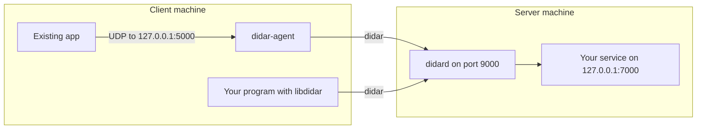

# Guide

How to build didar and use it, step by step. Phase 1 only: traffic is not encrypted yet. For every option, see [API](api.md).



## 1. Build

Requirements: Linux, `g++` with C++20, and CMake 3.20 or newer.

```bash
cmake -S 01-code -B 01-code/build -DCMAKE_BUILD_TYPE=Release
cmake --build 01-code/build
```

The build produces three things in `01-code/build/`:

| File | What it is |
| ---- | ---------- |
| `didard` | The server. |
| `didar-agent` | The client agent for existing apps. |
| `libdidar.a` | The client library for your own programs. Its header is `01-code/include/didar.h`. |

## 2. Run the server

On the server machine, start your UDP service on `127.0.0.1`, then start `didard` and allow the service's port:

```bash
./didard --port 9000 --allow 7000
```

Or put the settings in a file:

```ini
# didard.conf
port  = 9000
allow = 7000,7001
```

```bash
./didard -c didard.conf
```

`didard` prints `didard: ready on port 9000 ...` when it is listening. Open UDP port 9000 in the server's firewall; the services themselves stay closed to the outside.

## 3. Use it from an existing app

Use `didar-agent` when you cannot change the app. On the client machine:

```bash
./didar-agent --server 203.0.113.5:9000 --map 5000:7000
```

Then point the app at `127.0.0.1:5000` instead of the server. Everything it sends there reaches `127.0.0.1:7000` on the server, and replies come back to the app. Add one `--map` per service:

```bash
./didar-agent --server 203.0.113.5:9000 --map 5000:7000 --map 5001:7001
```

The agent only listens on `127.0.0.1`, so other machines cannot use it. If the server rejects a datagram, the agent prints the reason, for example `didar-agent: The target port is not open for didar on this server.`

## 4. Use it from your own code

Include `didar.h` and link `libdidar.a`. The library works from both C and C++.

```c
#include <poll.h>
#include <stdio.h>
#include <string.h>

#include "didar.h"

int main(void) {
    didar_client* c = didar_open("203.0.113.5", 9000);
    if (!c) {
        perror("didar_open");
        return 1;
    }

    int rc = didar_send(c, 7000, "hello", 5);
    if (rc < 0) {
        fprintf(stderr, "send: %s\n", didar_strerror(rc));
        return 1;
    }

    struct pollfd p = {didar_fd(c), POLLIN, 0};
    if (poll(&p, 1, 1000) != 1) {
        fprintf(stderr, "no reply\n");
        return 1;
    }

    char buf[1500];
    uint16_t from_port;
    rc = didar_recv(c, &from_port, buf, sizeof buf);
    if (rc < 0) {
        fprintf(stderr, "recv: %s\n", didar_strerror(rc));
        return 1;
    }
    printf("reply from port %u: %.*s\n", from_port, rc, buf);

    didar_close(c);
    return 0;
}
```

```bash
gcc -o echo_client echo_client.c -I01-code/include 01-code/build/libdidar.a
```

Things to know:

- The socket is non-blocking. Wait for replies with `poll` or `epoll` on `didar_fd`, or `didar_recv` returns `-EAGAIN`.
- One handle can reach every allowed port on the server: the target port is an argument of `didar_send`.
- A payload can be at most 1468 bytes; larger sends return `-EMSGSIZE`.
- Errors from the server arrive through `didar_recv` as negative codes. `didar_strerror` turns any negative return value into a message.

## 5. Run with Docker

`01-code/Dockerfile` builds one image per program. The build runs the requirement tests and fails if any of them fail.

```bash
docker build --target didard -t didard 01-code
docker build --target didar-agent -t didar-agent 01-code
```

Both images are configured with environment variables instead of flags:

| Variable | Image | Default | Flag |
| -------- | ----- | ------- | ---- |
| `DIDARD_PORT` | didard | 9000 | `--port` |
| `DIDARD_ALLOW` | didard | Required | `--allow`, comma-separated, e.g. `7000,7001` |
| `DIDARD_MAX_FLOWS` | didard | 65536 | `--max-flows` |
| `DIDARD_IDLE_SEC` | didard | 60 | `--idle-sec` |
| `DIDAR_AGENT_SERVER` | didar-agent | Required | `--server`, e.g. `203.0.113.5:9000` |
| `DIDAR_AGENT_MAP` | didar-agent | Required | One `--map` per space-separated pair, e.g. `"5000:7000 5001:7001"` |
| `DIDAR_AGENT_MAX_FLOWS` | didar-agent | 4096 | `--max-flows` |
| `DIDAR_AGENT_IDLE_SEC` | didar-agent | 60 | `--idle-sec` |

didard only forwards to `127.0.0.1` and didar-agent only listens on `127.0.0.1`, so each container must share the network of what it talks to.

On a Linux server, use the host network:

```bash
docker run -d --network host -e DIDARD_ALLOW=7000 didard
```

When your service runs in a container, attach didard to that container's network instead:

```bash
docker run -d --name my-service my-service-image
docker run -d --network container:my-service -e DIDARD_ALLOW=7000 didard
```

The agent works the same way. With `--network host`, apps on the client machine use `127.0.0.1:5000`:

```bash
docker run -d --network host \
  -e DIDAR_AGENT_SERVER=203.0.113.5:9000 \
  -e DIDAR_AGENT_MAP="5000:7000 5001:7001" \
  didar-agent
```

On Docker Desktop, `--network host` means the Docker VM, not your machine, so use the `--network container:<name>` form there.

If a required variable is missing, the container exits with a message such as `DIDARD_ALLOW: set DIDARD_ALLOW, e.g. 7000,7001`.

## 6. Troubleshooting

| Message | Cause | Fix |
| ------- | ----- | --- |
| The target port is not open for didar on this server. | The port is not in the server's `allow` list. | Add it to `allow` and restart `didard`. |
| Nothing is listening on the target port on the server. | No service is running on `127.0.0.1:<port>` on the server. | Start the service. |
| Server has reached its maximum number of flows; try again later. | Too many active flows. | Raise `max_flows`, or lower `idle_sec` so idle flows are closed sooner. |
| `didard: port and allow are required` | `didard` was started without `--port` or `--allow`. | Pass both, on the command line or in the config file. |
| No reply and no error | UDP port 9000 is blocked on the way to the server. | Open it in the firewall. |
