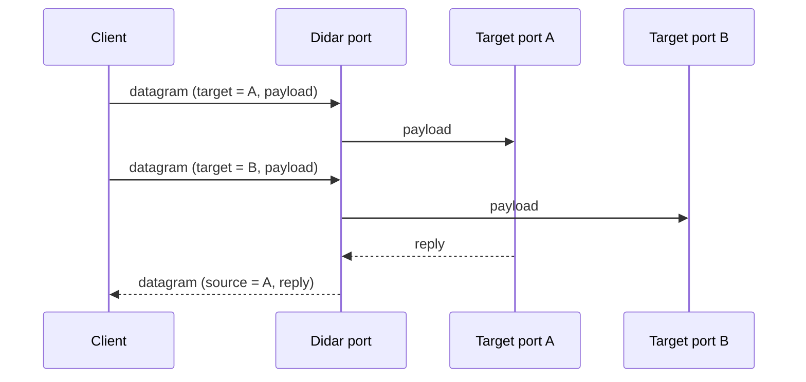
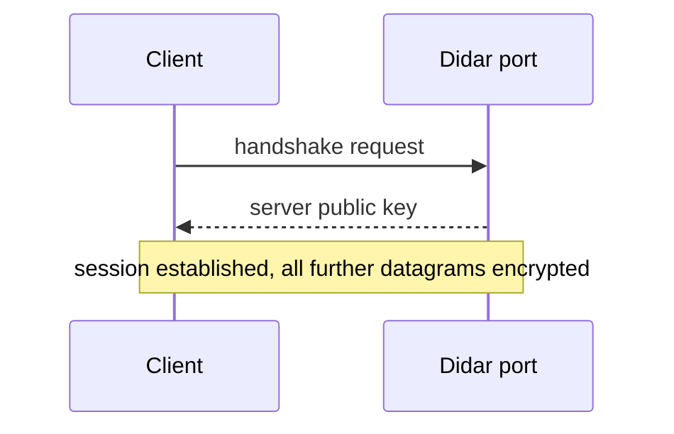
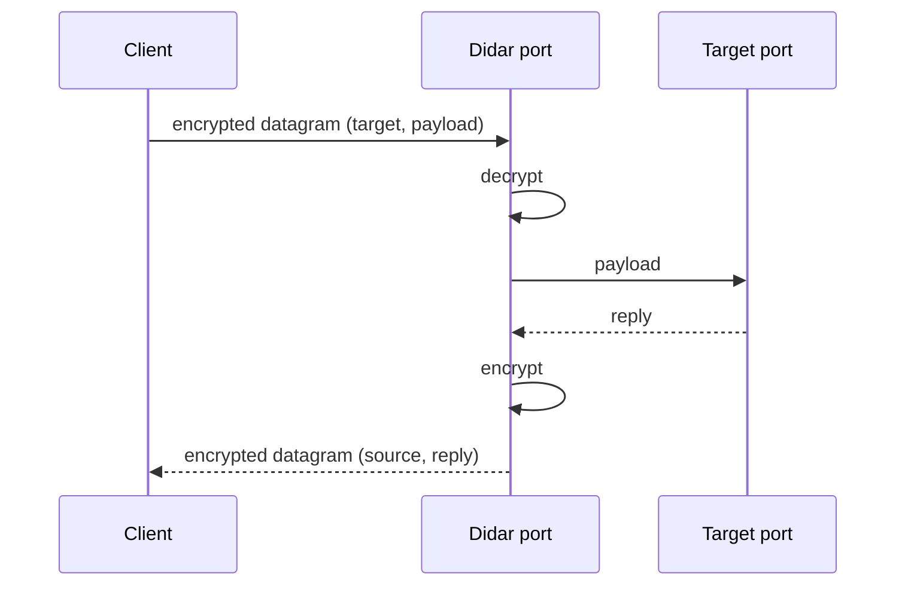
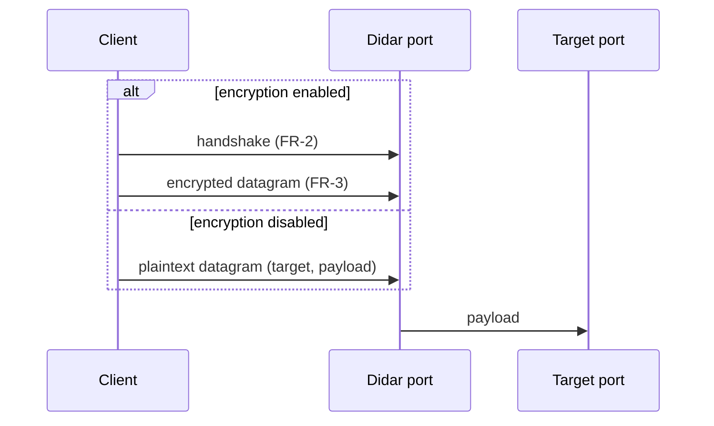

# Requirements

## Functional Requirements

| ID | Title | Description |
| -- | ----- | ----------- |
| FR-1 | Single-port demultiplexing | Clients send all datagrams to the didar port. Didar reads the target port from each datagram and forwards the payload to that target port on the server. Replies from the target port go back to the client through the didar port. |
| FR-2 | Key exchange handshake | Phase 2. Before any data is sent, the client and server run a handshake in which the server sends its public key to the client. |
| FR-3 | Encrypted transmission | Phase 2. After the handshake, every datagram between client and server is encrypted. |
| FR-4 | Optional encryption | Phase 2. Encryption (FR-2, FR-3) can be disabled; then didar works as in FR-1 with plaintext datagrams and no handshake. |

### FR-1: Single-port demultiplexing

### FR-2: Key exchange handshake

### FR-3: Encrypted transmission

### FR-4: Optional encryption

## Security Requirements

| ID | Title | Description |
| -- | ----- | ----------- |
| SR-1 | Confidentiality | Phase 2. When encryption is enabled, datagram contents, including the target port, must not be readable by anyone other than the client and the server. |
| SR-2 | Disable switch | Phase 2. Disabling encryption must be an explicit configuration choice; didar must never fall back to plaintext on its own. |

## Performance Requirements

| ID | Title | Description |
| -- | ----- | ----------- |
| PR-1 | Low overhead | TBD. Targets for added latency, header size, and throughput are not defined yet. |
