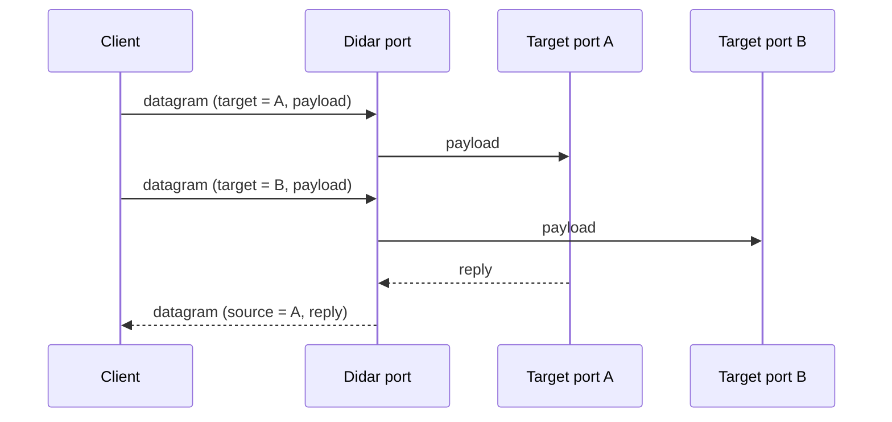
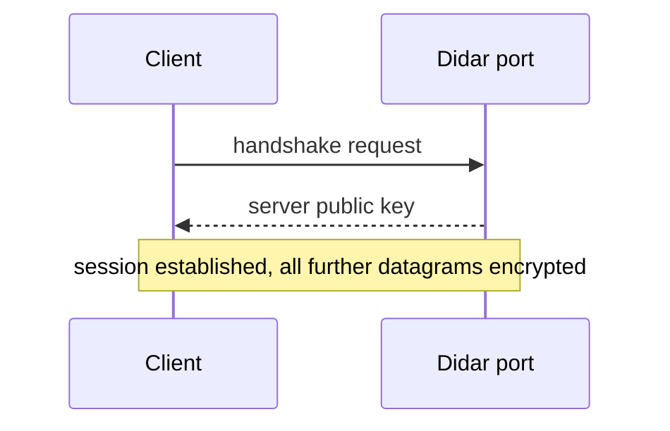
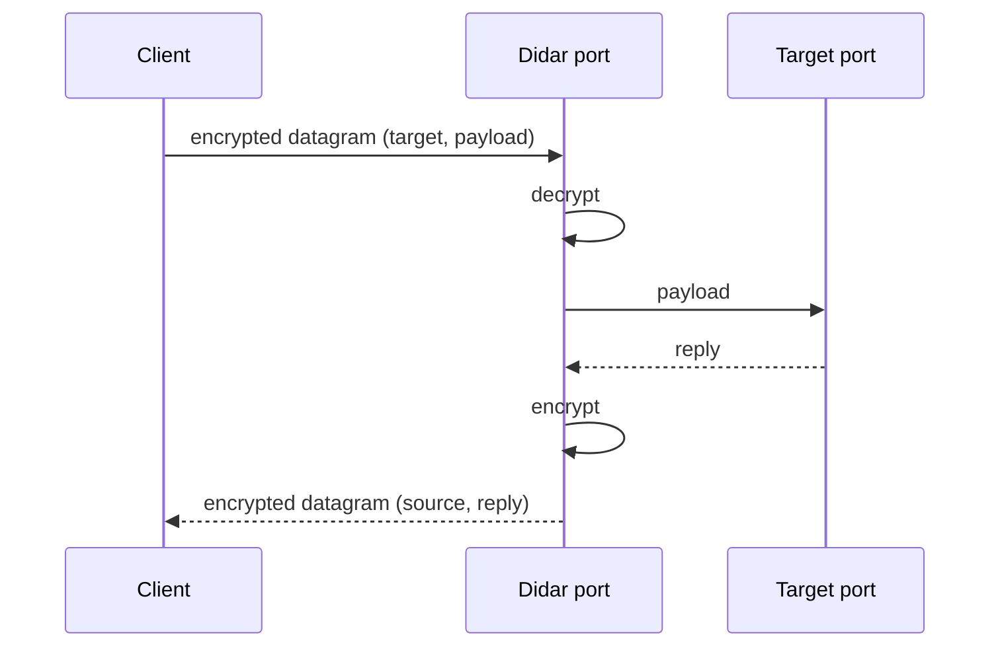
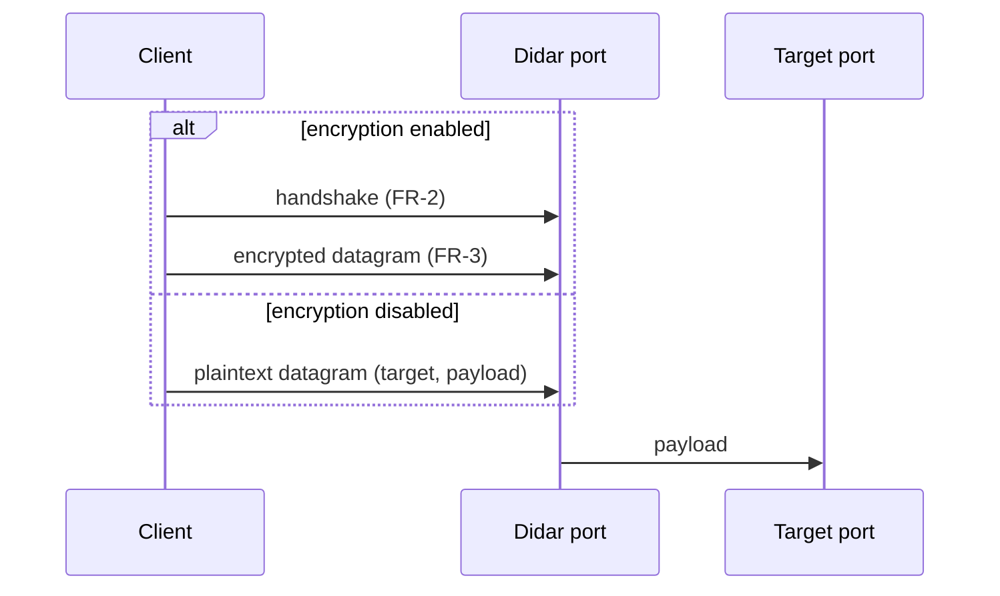
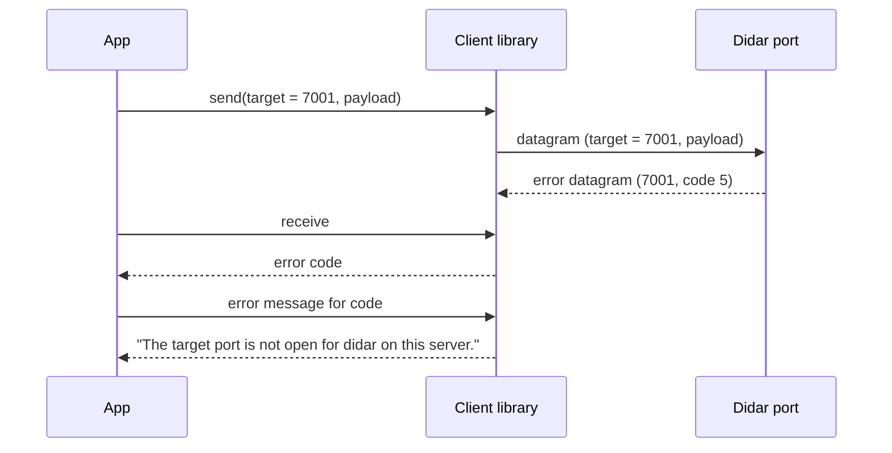

# Requirements

## Functional Requirements

| ID | Title | Description |
| -- | ----- | ----------- |
| FR-1 | Single-port demultiplexing | Clients send all datagrams to the didar port. Didar reads the target port from each datagram and forwards the payload to that target port on the server. Replies from the target port go back to the client through the didar port. |
| FR-2 | Key exchange handshake | Phase 2. Before any data is sent, the client and server run a handshake in which the server sends its public key to the client. |
| FR-3 | Encrypted transmission | Phase 2. After the handshake, every datagram between client and server is encrypted. |
| FR-4 | Optional encryption | Phase 2. Encryption (FR-2, FR-3) can be disabled; then didar works as in FR-1 with plaintext datagrams and no handshake. |
| FR-5 | Error reporting | When the server cannot forward a datagram, it replies with an error datagram carrying only a numeric code. The client library turns the code into a descriptive message. |

### FR-1: Single-port demultiplexing

### FR-2: Key exchange handshake

### FR-3: Encrypted transmission

### FR-4: Optional encryption

### FR-5: Error reporting

## Security Requirements

| ID | Title | Description |
| -- | ----- | ----------- |
| SR-1 | Confidentiality | Phase 2. When encryption is enabled, datagram contents, including the target port, must not be readable by anyone other than the client and the server. |
| SR-2 | Disable switch | Phase 2. Disabling encryption must be an explicit configuration choice; didar must never fall back to plaintext on its own. |
| SR-3 | Target allow-list | The server forwards only to target ports on its configured allow-list. Datagrams for any other port are rejected with an error and create no state. |
| SR-4 | Local-only agent | The client agent listens only on `127.0.0.1`, so other machines cannot use it. |

## Performance Requirements

| ID | Title | Description |
| -- | ----- | ----------- |
| PR-1 | Low size overhead | Didar adds at most 4 bytes per datagram with encryption disabled, and at most 32 bytes per datagram with encryption enabled (header, nonce, and authentication tag together), on top of the 8-byte UDP header. The handshake is not counted. |
| PR-2 | Low demultiplexing time | Demultiplexing adds at most 50 µs at p99 per datagram with encryption disabled, and at most 100 µs at p99 with encryption enabled, measured over loopback with 1200-byte payloads on one core of a commodity x86-64 machine. |
